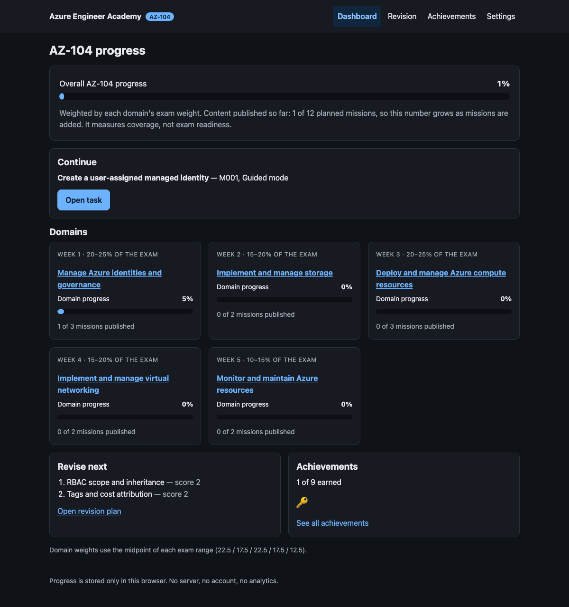
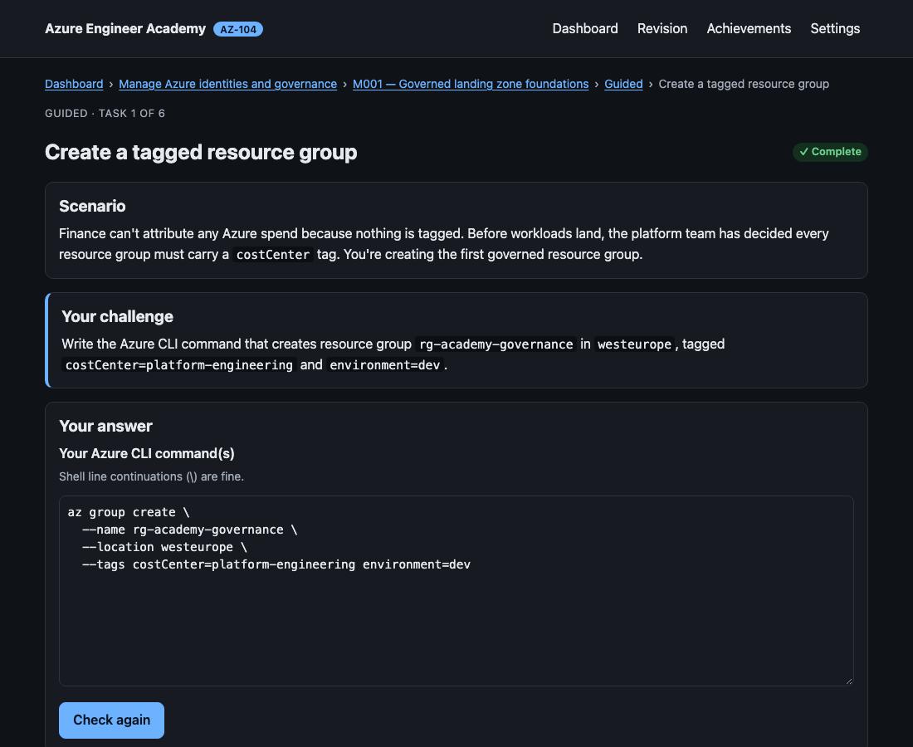

# Azure Engineer Academy

> A hands-on, mentor-driven lab for learning real Azure engineering while preparing for the
> **Microsoft AZ-104** (Azure Administrator) certification. You learn by building,
> breaking, and fixing infrastructure — not by watching videos.




-339933)


## What this is

Each **mission** is a realistic platform-engineering scenario mapped to a specific AZ-104
objective. Every mission gives you both an **Azure CLI** and a **Bicep** implementation of the
same infrastructure, so you learn the imperative and declarative paths and when to use each.
Missions come in three difficulty tracks — **Guided**, **Independent**, and **Production
Incident** — and build toward a capstone: an Azure-hosted DevOps application platform.

This repo is written for an experienced engineer. It translates existing Linux, networking,
CI/CD, and observability knowledge into Azure services rather than teaching fundamentals from
scratch.

## Quick start

### Open the interactive academy

Practise in the browser: work tasks, check your answers, open hints one at a time, take the
quizzes, and send your answer for mentor review. Progress stays in your browser. You need only
Python 3, which macOS already includes. Run this from the repository root:

```sh
python3 -m http.server 8000
```

Then open http://localhost:8000/academy/ and press Ctrl+C in the terminal when you're done.
How tasks, rule checks and the mentor review work: [academy/README.md](academy/README.md).



### Work with the infrastructure code

You need the Azure CLI and the Bicep CLI. Compilation and linting of the templates need
**no Azure account and cost nothing**. Actually deploying resources needs a subscription and
may be billable — every mission flags that and ships a cleanup script.

Install the tools (macOS):

```sh
brew install azure-cli
az bicep install
```

Or install the Bicep CLI standalone without the Azure CLI (Apple Silicon):

```sh
curl -sSL -o bicep https://github.com/Azure/bicep/releases/download/v0.49.2/bicep-osx-arm64
chmod +x bicep
mkdir -p ~/.local/bin && mv bicep ~/.local/bin/bicep
```

Validate a mission's Bicep locally (no Azure login needed):

```sh
bicep build missions/mission-001-identity-governance/bicep/main.bicep --stdout > /dev/null
bicep lint missions/mission-001-identity-governance/bicep/main.bicep
```

Then open [missions/mission-001-identity-governance/README.md](missions/mission-001-identity-governance/README.md)
and start the Guided track.

## Repository layout

| Path | Purpose |
|------|---------|
| [academy/](academy/) | The interactive learning interface (static, no dependencies) and its tests |
| [ROADMAP.md](ROADMAP.md) | The five AZ-104 domains, mission list, and status |
| [PROGRESS.md](PROGRESS.md) | Your personal learning log and achievements |
| [docs/mission-template.md](docs/mission-template.md) | The structure every mission follows |
| [docs/architecture.md](docs/architecture.md) | Platform + capstone architecture and data flow |
| [docs/adr/](docs/adr/) | Architecture decision records |
| [missions/](missions/) | The missions themselves (CLI + Bicep + exercises) |
| [assessments/](assessments/) | Per-week exam-style assessments |
| [capstone/](capstone/) | The evolving capstone platform spec |

## How to work through a mission

1. Read the scenario and short theory in the mission README.
2. Work the tasks in the academy: write the CLI or Bicep yourself, check it, and use hints only
   when stuck. The solution unlocks after your first attempt.
3. Send each answer for mentor review with **Copy review prompt**, then record the verdict.
4. If you have a subscription, deploy for real and run the mission's validation script.
5. Take the mission quiz, then revise the topics the dashboard flags as weak.
6. Optionally keep a written log in [PROGRESS.md](PROGRESS.md). The academy tracks progress
   for you in the browser.

## Development

```sh
bicep build <path-to>.bicep --stdout > /dev/null
bicep lint <path-to>.bicep
shellcheck missions/*/cli/*.sh
```

CI job on pull requests and pushes to `main`:

- **validate-bicep** — installs the Bicep CLI and runs `bicep build` + `bicep lint` on every
  `.bicep` file in the repo. See [.github/workflows/validate-bicep.yml](.github/workflows/validate-bicep.yml).
- **validate-academy** — `node --check` on every module, then the unit and content-integrity
  tests (`unit`); plus a headless-Chrome smoke test (`e2e`, non-blocking for now). See
  [.github/workflows/validate-academy.yml](.github/workflows/validate-academy.yml) and the test
  commands in [academy/README.md](academy/README.md#test).

## Known issues / status

- **Rule checks are pattern rules, not a reviewer.** They can reject a valid answer written in a
  form nobody anticipated, or pass one with a subtle mistake. A mentor PASS overrides them; see
  [ADR 0003](docs/adr/0003-static-academy-rule-checks-and-mentor-review.md).
- **Progress lives in one browser.** It isn't synced across browsers or devices, and clearing
  site data deletes it. Use Settings → Export for a backup.
- **Mentor verdicts are self-reported.** The academy can't see your mentor chat.
- The academy needs to be served (`python3 -m http.server`). Opening `academy/index.html`
  straight from disk shows a message with that command instead of the app.
- **Only Mission 001 is complete.** It is the reference implementation; Weeks 2–5 are planned.
- Bicep templates are compiled and linted locally and in CI, but **not deployed** against a
  live subscription in this repo. Deploy against your own subscription at your own cost.

## License

MIT — see [LICENSE](LICENSE).
