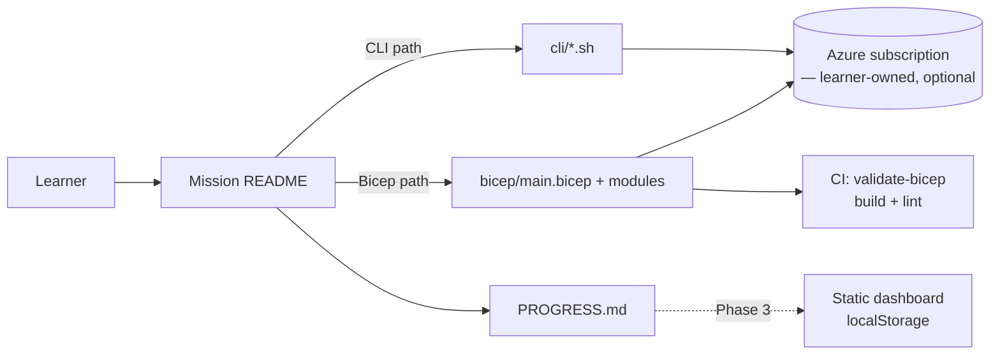
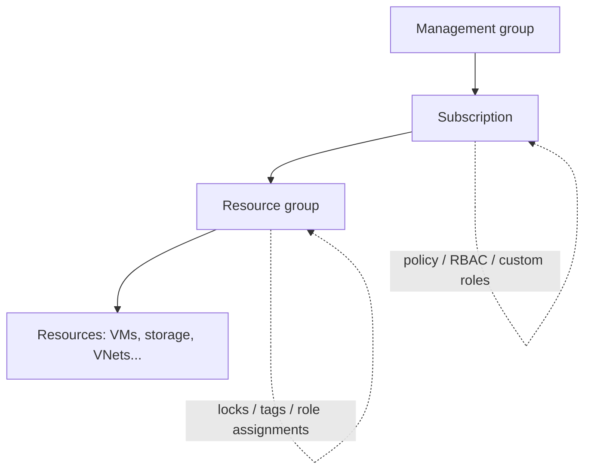
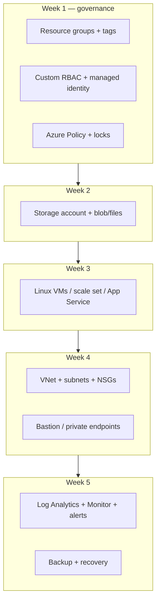

# Architecture

This document explains how the academy is put together and how the capstone platform grows as
you complete missions.

## Learning platform

The platform is deliberately static and dependency-light. There is no backend, database, or
auth system — progress lives in [PROGRESS.md](../PROGRESS.md) today and will move to a
static, local-storage dashboard in Phase 3 (see [ADR 0002](adr/0002-local-progress-no-backend.md)).

Every mission ships the **same infrastructure twice** — once imperatively via the Azure CLI and
once declaratively via Bicep — so you internalise both and learn when each is appropriate
(see [ADR 0001](adr/0001-cli-and-bicep-dual-track.md)).

## Deployment scopes

Governance resources do not all live at the same scope. This matters for Mission 001 and
recurs throughout the curriculum.

A Bicep file declares its `targetScope` (`resourceGroup`, `subscription`, `managementGroup`, or
`tenant`). Picking the wrong scope is a common early mistake and a frequent exam trap.

## Capstone: Azure DevOps application platform

The capstone is assembled incrementally — never all at once. Each week adds the layer you just
learned, so by the end you have deployed a coherent platform from Bicep and GitHub Actions.

## Where to look

| You want to… | Look in |
|--------------|---------|
| See the mission list and status | [ROADMAP.md](../ROADMAP.md) |
| Understand the mission format | [mission-template.md](mission-template.md) |
| Start learning | [missions/mission-001-identity-governance/README.md](../missions/mission-001-identity-governance/README.md) |
| Read a design decision | [adr/](adr/) |
| See how the capstone evolves | [capstone/README.md](../capstone/README.md) |
| Understand CI | [.github/workflows/validate-bicep.yml](../.github/workflows/validate-bicep.yml) |
