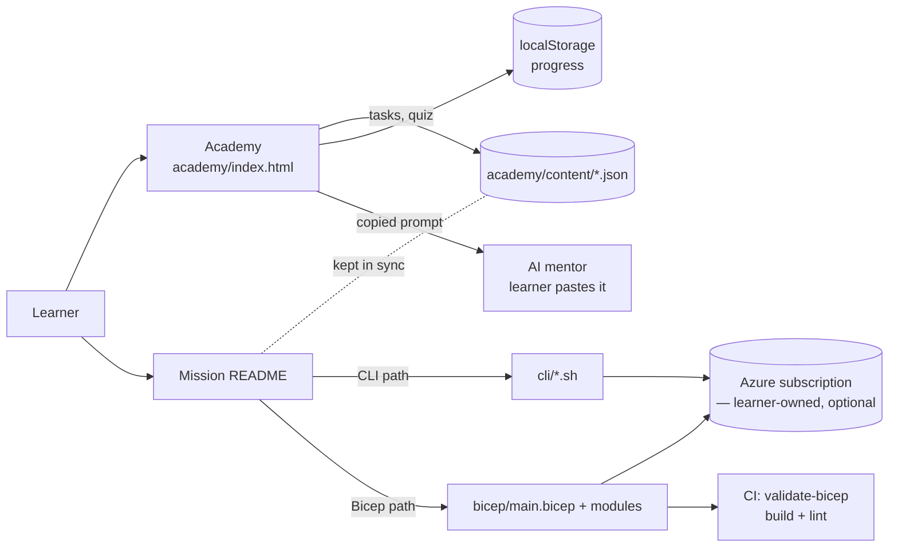
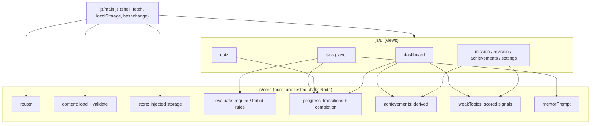
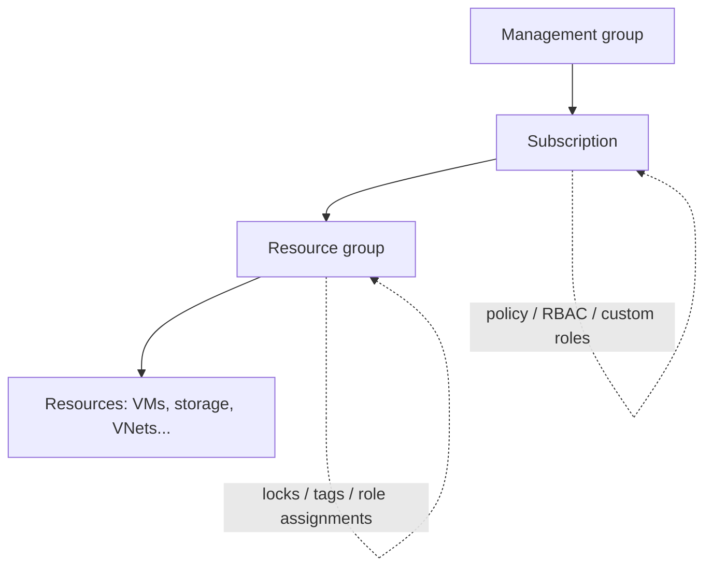
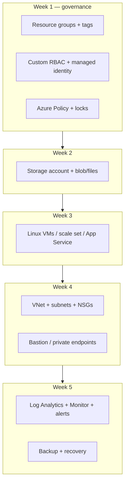

# Architecture

This document explains how the academy is put together and how the capstone platform grows as
you complete missions.

## Learning platform

The platform is deliberately static and dependency-light. There is no backend, database, or
auth system. Progress lives in the learner's browser, managed by the interactive academy (see
[ADR 0002](adr/0002-local-progress-no-backend.md) and
[ADR 0003](adr/0003-static-academy-rule-checks-and-mentor-review.md)).

## Academy

The academy is plain HTML, CSS and ES modules served as static files. Course content is JSON;
the code is generic, so a new mission is a content change.

**How an answer is judged.** `evaluate()` normalises the answer (it joins `\` line
continuations and collapses spaces), then runs the task's checks. A `require` rule passes on a
match and a `forbid` rule passes on no match. An empty answer never passes. A task is
**complete** when the mentor verdict is PASS, or when the rule checks passed, the task isn't
`review: "mentor"`, and the mentor hasn't said NEEDS WORK.

**How progress is weighted.** A mission's fraction is (complete tasks + correctly answered quiz
questions) / (tasks + questions). A domain's fraction is the mean over its *planned* missions,
with unpublished ones counting as 0. Overall progress weights each domain by the midpoint of
its exam-weight range (22.5 / 17.5 / 22.5 / 17.5 / 12.5).

**How weak topics are ranked.** Each task and question carries topics. Struggle signals add
weight to them: a first-try quiz miss +2, solution revealed before solving +2, mentor NEEDS
WORK +2, each hint +0.5, each failed attempt +0.5 (at most 4 counted per task). Topics are
sorted by score, and the revision plan lists unfinished tasks first, with Microsoft Learn links.

Every mission ships the **same infrastructure twice** — once imperatively via the Azure CLI and
once declaratively via Bicep — so you internalise both and learn when each is appropriate
(see [ADR 0001](adr/0001-cli-and-bicep-dual-track.md)).

## Deployment scopes

Governance resources do not all live at the same scope. This matters for Mission 001 and
recurs throughout the curriculum.

A Bicep file declares its `targetScope` (`resourceGroup`, `subscription`, `managementGroup`, or
`tenant`). Picking the wrong scope is a common early mistake and a frequent exam trap.

## Capstone: Azure DevOps application platform

The capstone is assembled incrementally — never all at once. Each week adds the layer you just
learned, so by the end you have deployed a coherent platform from Bicep and GitHub Actions.

## Where to look

| You want to… | Look in |
|--------------|---------|
| See the mission list and status | [ROADMAP.md](../ROADMAP.md) |
| Understand the mission format | [mission-template.md](mission-template.md) |
| Start learning | the academy ([academy/README.md](../academy/README.md)) and [missions/mission-001-identity-governance/README.md](../missions/mission-001-identity-governance/README.md) |
| Change a task, hint, check or quiz question | `academy/content/missions/<id>.json` (keep the mission README in sync) |
| Change how answers are checked or progress is counted | `academy/js/core/evaluate.js`, `academy/js/core/progress.js` |
| Change weak-topic scoring or achievements | `academy/js/core/weakTopics.js`, `academy/js/core/achievements.js` |
| Change the mentor prompt | `academy/js/core/mentorPrompt.js` |
| Test the academy | `academy/tests/` (`node --test`) and `academy/tests/e2e/smoke.mjs` |
| Read a design decision | [adr/](adr/) |
| See how the capstone evolves | [capstone/README.md](../capstone/README.md) |
| Understand CI | [.github/workflows/validate-bicep.yml](../.github/workflows/validate-bicep.yml) |
| Understand the academy's CI | [.github/workflows/validate-academy.yml](../.github/workflows/validate-academy.yml) |
