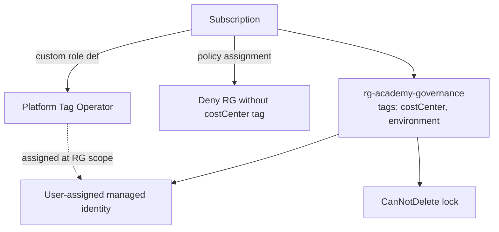

# Mission 001 — Governed landing zone foundations

| | |
|---|---|
| **AZ-104 objective** | Manage Azure identities and governance → *Manage access to Azure resources* + *Manage Azure subscriptions and governance* |
| **Difficulty** | Guided → Independent → Production Incident (all three tracks below) |
| **Estimated time** | ~60 min |
| **Prerequisites** | An Azure subscription where you have **Owner** (or Contributor + User Access Administrator). The Azure CLI and/or Bicep CLI installed. |
| **Billable?** | **Effectively free.** Resource groups, custom roles, role assignments, policy, locks, and a user-assigned managed identity carry **no compute cost**. You still run `cleanup.sh` to keep the tenant tidy. |

> **Mentor note.** Attempt every task yourself before expanding a `<details>` block. The point
> is to build the muscle, not to read the answer. When we work this mission live, I give you one
> task at a time, review your attempt, and hint before revealing.

---

## Scenario

You've joined the platform engineering team at a company moving workloads into Azure. Right now
anyone with access can create resources anywhere, nothing is tagged, cost is unattributable, and
a mis-click could delete a production resource group. Before any workloads land, the team wants a
**governed landing zone**: a consistent resource-group layout, least-privilege access, enforced
tagging for cost attribution, protection against accidental deletion, and a non-secret identity
that the CI/CD pipeline will use later.

Your job: stand up that governance baseline — first by hand with the CLI (so you understand each
moving part), then as repeatable Bicep (so the team can review and redeploy it).

## Learning objectives

After this mission you can:

- Create and tag resource groups and explain why tags matter for governance and cost.
- Author a **custom RBAC role** and assign it at the right scope using least privilege.
- Create a **user-assigned managed identity** and grant it a role.
- Write and assign an **Azure Policy** that enforces a rule (deny untagged resource groups).
- Apply a **management lock** and reason about what it does and doesn't block.
- Explain **deployment scope** (subscription vs resource group) and why it matters.
- Do all of the above both imperatively (CLI) and declaratively (Bicep), and say when to use each.

## Architecture



- **Services:** Microsoft Entra ID (the identity), Azure RBAC (custom role + assignment), Azure
  Policy, management locks, resource groups and tags.
- **Security:** least privilege (the custom role can read and tag but not delete); a managed
  identity instead of a stored secret; policy as a preventive guardrail.
- **Cost:** none of these resources are billed for existence. Tags are what make *future* cost
  attributable.

## Short theory (mapped to what you already know)

| You know (Linux / DevOps) | Azure equivalent in this mission |
|---------------------------|----------------------------------|
| Users, groups, `sudoers`, capabilities | Entra identities + **RBAC roles** (a role = a set of `actions`, like allowed syscalls). A **managed identity** is a service account whose credential Azure rotates for you — no password to leak. |
| An OU / folder hierarchy | **Management group → subscription → resource group → resource**. Access and policy inherit **down** the tree. |
| OPA / admission controllers / config-as-code guardrails | **Azure Policy** — evaluates resources and can **deny**, **audit**, or **deployIfNotExists**. |
| `chattr +i` / protected branches | **Management locks** — `CanNotDelete` or `ReadOnly` on a scope. |
| Terraform `plan` vs `apply` | Bicep `what-if` vs `az deployment ... create`. |

Three ideas that trip people up:

1. **Scope.** RBAC, policy, and locks all apply at a *scope* and inherit downward. A role
   assigned at the subscription is broader than one at a resource group. A Bicep file declares
   its scope with `targetScope`; to touch a different scope you use a **module** (that is exactly
   why the managed identity, role assignment, and lock in [bicep/main.bicep](bicep/main.bicep) are
   modules scoped to the resource group, while the custom role and policy sit at the subscription).
2. **Role definition vs role assignment.** The *definition* says what the role can do; the
   *assignment* binds (definition × principal × scope). You need both. Each has its own
   scope, and the two are easy to mix up. See the next section.
3. **CLI vs Bicep.** The CLI is imperative — great for exploring and one-off fixes. Bicep is
   declarative — it describes the desired end state and is what you commit, review, and redeploy.
   See [ADR 0001](../../docs/adr/0001-cli-and-bicep-dual-track.md).

### Assignable scopes vs assignment scope

A custom role involves **two different scopes**, and they answer different questions:

| | `AssignableScopes` (on the role **definition**) | `scope` (on the role **assignment**) |
|---|---|---|
| Question it answers | *Where is this role allowed to be assigned?* | *Where does this principal actually get these permissions?* |
| Grants any access? | **No.** It is a fence around the role's availability. | **Yes.** This is what grants access, at that scope and below. |
| In this mission | `/subscriptions/<id>`, so the role can be assigned anywhere in the subscription | `/subscriptions/<id>/resourceGroups/rg-academy-governance` (just the RG) |
| Rule | Can list several management groups, subscriptions or RGs | Must be **at or below** one of the role's assignable scopes |

So the role is *available* across the whole subscription, but the identity *holds* it only on
one resource group. Assigning it at a scope outside `AssignableScopes` (for example another
subscription) fails. Also, an assignable scope wider than you need doesn't leak any access by
itself. Access comes only from assignments. Keep `AssignableScopes` as narrow as the places
you really intend to use the role, because it limits who can be handed the role later.

`validate.sh` checks both: the role's assignable scope is the subscription, and the assignment's
scope is exactly the resource group (and not anything wider).

---

## Track A — Guided

Work the tasks in order. Try each yourself, then check the solution.

### Task 1 — Create a tagged resource group

**Requirement:** a resource group named `rg-academy-governance` in your preferred region, tagged
`costCenter=platform-engineering` and `environment=dev`.
**Expected outcome:** `az group show` returns the group with both tags.

<details><summary>Hint</summary>

`az group create` takes `--tags key=value key=value`. Tags are space-separated.
</details>

<details><summary>Solution — CLI</summary>

```sh
az group create \
  --name rg-academy-governance \
  --location westeurope \
  --tags costCenter=platform-engineering environment=dev managedBy=cli
```
</details>

<details><summary>Solution — Bicep</summary>

Subscription-scoped, because a resource group is a subscription-level resource:

```bicep
targetScope = 'subscription'

resource rg 'Microsoft.Resources/resourceGroups@2024-03-01' = {
  name: 'rg-academy-governance'
  location: 'westeurope'
  tags: {
    costCenter: 'platform-engineering'
    environment: 'dev'
    managedBy: 'bicep'
  }
}
```

Deploy your own snippet file (it has no parameter file, so pass it directly):
`az deployment sub create --location westeurope --template-file main.bicep`. The reference
implementation uses `main.bicepparam` instead. See **Deploy** below.
</details>

### Task 2 — Create a user-assigned managed identity

**Requirement:** an identity `id-platform-automation` in the resource group.
**Expected outcome:** it has a `principalId` (object ID) you can use in a role assignment.

<details><summary>Hint</summary>

`az identity create`. Read the object ID back with `az identity show --query principalId -o tsv`.
</details>

<details><summary>Solution — CLI</summary>

```sh
az identity create --name id-platform-automation \
  --resource-group rg-academy-governance --location westeurope
az identity show --name id-platform-automation \
  --resource-group rg-academy-governance --query principalId -o tsv
```
</details>

<details><summary>Solution — Bicep</summary>

See [bicep/modules/managed-identity.bicep](bicep/modules/managed-identity.bicep). It outputs
`principalId`, which `main.bicep` feeds into the role-assignment module.
</details>

### Task 3 — Author a custom role and assign it (least privilege)

**Requirement:** a custom role that can **read everything and manage tags** but **cannot create
or delete** resources. Assign it to the managed identity **at the resource-group scope**.
**Expected outcome:** `az role assignment list --scope <rg>` shows the identity with your role.

<details><summary>Hint</summary>

A custom role is JSON with `Actions`, `NotActions`, and `AssignableScopes`. Read-all is `*/read`.
Tag management is `Microsoft.Resources/tags/write` and `.../tags/delete`. For the assignment,
use `--assignee-object-id` with `--assignee-principal-type ServicePrincipal` (a managed identity
is a service principal), not `--assignee` by name.
</details>

<details><summary>Why not just use a built-in role?</summary>

You could assign **Reader** + **Tag Contributor** and get close. Authoring a custom role here
teaches the mechanics and gives you exactly one role to reason about. In production, **prefer a
built-in role** when one fits — fewer things to maintain — and reach for a custom role only when
no built-in matches. That trade-off is the real lesson.
</details>

<details><summary>Solution — CLI</summary>

See [cli/deploy.sh](cli/deploy.sh) step 3–4. The role JSON and the assignment (with a short
retry loop for Entra replication lag on a brand-new identity) are there in full.
</details>

<details><summary>Solution — Bicep</summary>

The `tagOperator` role definition in [bicep/main.bicep](bicep/main.bicep) and the
[role-assignment module](bicep/modules/role-assignment.bicep), whose assignment **name is a
deterministic GUID** (`guid(resourceGroup().id, principalId, roleDefinitionId)`) so redeploying
is idempotent instead of creating duplicates.
</details>

### Task 4 — Enforce tagging with Azure Policy

**Requirement:** a policy that **denies** creating a resource group without a `costCenter` tag,
assigned at the subscription.
**Expected outcome:** creating an untagged RG fails with a policy error; a tagged one succeeds.

<details><summary>Solution — CLI</summary>

See [cli/deploy.sh](cli/deploy.sh) step 5 — `az policy definition create` with the deny rule,
then `az policy assignment create` at the subscription scope.
</details>

<details><summary>Solution — Bicep</summary>

The `requireCostCenter` definition and `requireCostCenterAssignment` in
[bicep/main.bicep](bicep/main.bicep).
</details>

### Task 5 — Lock the resource group

**Requirement:** a `CanNotDelete` lock on the resource group.
**Expected outcome:** attempting to delete the RG is blocked until the lock is removed.

<details><summary>Solution — CLI / Bicep</summary>

CLI: `az lock create --name donotdelete-governance-rg --lock-type CanNotDelete --resource-group rg-academy-governance`.
Bicep: the [rg-lock module](bicep/modules/rg-lock.bicep), scoped to the RG from `main.bicep`.
</details>

Run the whole Guided track at once with the reference scripts/templates (see **Deploy** below),
then move to validation.

---

## Track B — Independent

No step-by-step. Meet these requirements your way, in **both** CLI and Bicep, then diff your work
against the reference files.

- A resource group `rg-academy-prod` tagged `costCenter=<your choice>` and `environment=prod`.
- A user-assigned managed identity granted the **built-in `Reader`** role at that RG (look up the
  built-in role — do **not** hardcode a GUID you can't explain).
- The same `costCenter` tag-enforcement policy, but in **audit** mode instead of deny — and be
  ready to explain the difference.
- A `ReadOnly` lock instead of `CanNotDelete` — and predict what breaks under it before you test.

<details><summary>Checkpoints</summary>

- Built-in Reader's role definition ID ends in `acdd72a7-3385-48ef-bd42-f606fba81ae7`. Prefer
  referencing it via `subscriptionResourceId('Microsoft.Authorization/roleDefinitions', '<guid>')`
  in Bicep rather than pasting a full path.
- `audit` records non-compliance in the policy compliance view but **allows** the deployment;
  `deny` blocks it outright. Audit is how you roll out a policy safely before enforcing it.
- A `ReadOnly` lock blocks not just deletes but also many **write/list** operations (e.g. listing
  storage keys), which surprises people. That's the point of predicting first.
</details>

---

## Track C — Production Incident

> A teammate "fixed a permissions issue" last night. This morning the pipeline's identity can no
> longer deploy, and nobody can delete a stale resource group. Diagnose and fix — don't just
> rebuild.

Reproduce the broken state and work it as an incident:

1. The CI managed identity was assigned the **custom Tag Operator** role at the resource group and
   nothing else, yet the pipeline needs to **create** resources. **What's the symptom, what's the
   root cause, and what's the least-privilege fix?**
2. Someone tried to delete `rg-academy-governance` and got
   `Code: ScopeLocked`. **Why, and what's the correct, auditable way to proceed?**
3. A new resource group creation is failing with
   `RequestDisallowedByPolicy`. **Which policy, and what are the two legitimate ways to make the
   request succeed?**

<details><summary>Answers</summary>

1. **Symptom:** `AuthorizationFailed` on resource creation. **Cause:** the Tag Operator role
   grants `*/read` + tag writes only — no `write` on the resource types being created. **Fix:**
   assign a role that includes the needed create/write actions at the **narrowest** scope that
   works (e.g. a built-in role like **Contributor** scoped to just the workload RG, or a custom
   role with exactly the required `Microsoft.<provider>/.../write` actions) — not Owner at the
   subscription. Least privilege means widening by the smallest step that unblocks the task.
2. **`ScopeLocked`** means a `CanNotDelete` lock is in effect. The correct path is to **remove the
   lock deliberately** (`az lock delete ...`) — which is an auditable action — then delete, rather
   than hunting for a way around it. The lock did its job: it forced a conscious decision.
3. The **`require-costcenter-tag`** assignment denies RGs without a `costCenter` tag. Two
   legitimate fixes: **(a)** include the `costCenter` tag on the new RG, or **(b)** if the policy
   is wrong for this case, change it to `audit`/add an exemption — a governance decision, not a
   silent bypass. Disabling the policy to push a change through is the wrong move.
</details>

---

## Deploy (reference implementation)

**Bicep (declarative — what you'd commit):** values come from
[bicep/main.bicepparam](bicep/main.bicepparam). It names the template through its `using`
line, so you pass only `--parameters`, without `--template-file`. Edit the `.bicepparam`
file to change the region, names or environment. Always run `what-if` first.

```sh
cd bicep
az deployment sub what-if --location westeurope --parameters main.bicepparam
az deployment sub create --location westeurope --parameters main.bicepparam
```

`--location` here is where the *deployment record* is stored, which a subscription-scope
deployment requires. Keep it the same as the `location` in the parameter file.

**CLI (imperative — same result, step by step):**

```sh
cd cli
./deploy.sh
```

Override defaults with environment variables, for example:

```sh
LOCATION=northeurope ENVIRONMENT=test ./deploy.sh
```

| Variable | Default | Rules (checked before any Azure call) |
|---|---|---|
| `LOCATION` | `westeurope` | not empty |
| `RG_NAME` | `rg-academy-governance` | letters, digits, `. _ - ( )`; up to 90 chars |
| `IDENTITY_NAME` | `id-platform-automation` | letters, digits, `- _`; 3–128 chars |
| `COST_CENTER` | `platform-engineering` | not empty (it is the enforced tag value) |
| `ENVIRONMENT` | `dev` | `dev`, `test` or `prod`, the same values the Bicep `@allowed` list accepts |

A variable you leave **unset** gets the default. A variable set to an **empty** value
(e.g. `LOCATION=`) is rejected, because that's almost always a typo. An invalid value stops
the script with a one-line `ERROR:` and exit code 1 before anything is created. All three
scripts share this configuration through [cli/_common.sh](cli/_common.sh), so `validate.sh`
and `cleanup.sh` must be run with the same variables you deployed with.

If the role assignment still fails after 5 attempts (15 s apart, to allow for Entra
replication lag), `deploy.sh` prints the Azure CLI's last error and **stops with exit code 1**.
It doesn't go on to the policy and lock steps.

## Validation

```sh
cd cli
./validate.sh
```

`validate.sh` checks the **configuration**, not just that objects exist. Every `FAIL` shows
expected vs actual, and any `FAIL` exits non-zero:

| Area | What is checked |
|---|---|
| Resource group | exists; `costCenter` tag equals `COST_CENTER` |
| Custom role | grants `*/read`, `tags/write`, `tags/delete`; has **no** `*`, `*/write` or `*/delete`; assignable scope is the subscription |
| Role assignment | principal is the identity's `principalId`; role is the custom role; scope is **exactly** the RG |
| Policy definition | effect is `deny`; rule targets resource groups and tests `tags[costCenter]` |
| Policy assignment | scope is the subscription; enforcement mode is `Default` (not `DoNotEnforce`) |
| Lock | level is `CanNotDelete` |

**Test the scripts without Azure (free, offline):** the suite runs the real scripts against a
fake `az` and checks exit codes, error messages, and which calls were made. It works from any
directory; from `cli/`:

```sh
../tests/test_cli.sh
```

**Compile/lint the Bicep without any Azure login (free):**

```sh
bicep build bicep/main.bicep --stdout > /dev/null
bicep lint bicep/main.bicep
bicep build-params bicep/main.bicepparam --stdout > /dev/null
```

Common failure cases:

- `AuthorizationFailed` creating the role/assignment → your principal lacks **User Access
  Administrator**/Owner.
- Role assignment fails right after identity creation → **Entra replication lag**; the deploy
  script retries 5 times and then stops with the CLI's error. Bicep handles the dependency
  ordering.
- `RequestDisallowedByPolicy` on an unrelated RG → your new policy is working; add the tag.

## Troubleshooting exercise

You assigned the Tag Operator role but the identity still can't read a resource. List what you'd
check, in order, before concluding the role is wrong.

<details><summary>A good checklist</summary>

1. Is the assignment at a scope that **includes** the resource? (RBAC inherits down, not up.)
2. Did you assign to the **principalId (object ID)** of the identity, not its client ID or name?
3. Has enough time passed for the assignment to propagate (usually seconds, occasionally minutes)?
4. Does the role's `actions` actually include the operation? `*/read` covers reads; a specific
   data-plane action (e.g. reading blob *content*) needs a `dataActions` entry, which this role
   doesn't grant.
</details>

## Production considerations

- **Security:** prefer built-in roles; assign at the narrowest scope; use managed identities over
  secrets; roll policies out as `audit` before `deny`.
- **Reliability:** locks prevent accidental deletion of stateful resources; deterministic
  assignment names keep redeploys idempotent.
- **Scalability:** define governance at the **management group** so new subscriptions inherit it,
  rather than repeating it per subscription.
- **Cost:** these objects are free; the tagging they enforce is what makes spend attributable in
  Cost Management.
- **Operations:** everything here belongs in source control (the Bicep) and a pipeline; the CLI
  path is for understanding and break-glass.
- **Trade-off:** custom role (precise, more to maintain) vs built-in role (coarser, zero
  maintenance). Default to built-in.

## AZ-104 assessment

Attempt before expanding answers.

**Q1.** You assign **Reader** to a user at a resource group, and **Contributor** to the same user
at the subscription. What is their effective access on resources in that resource group?

<details><summary>Answer</summary>

**Contributor.** RBAC is additive and permissions inherit downward; the subscription-level
Contributor applies to the RG, and the union of Reader + Contributor is Contributor. (RBAC has no
explicit *deny* here — that's a separate feature.)
</details>

**Q2.** A Bicep file starts with `targetScope = 'subscription'`. Which of these can it create
**directly** (not via a module)? (a) a storage account, (b) a resource group, (c) a role
assignment on a resource group, (d) a policy assignment at the subscription.

<details><summary>Answer</summary>

**(b) and (d).** A resource group and a subscription-scope policy assignment are subscription-level
resources. A storage account (a) is resource-group-scoped, and an RG-scoped role assignment (c)
targets a different scope — both need a **module**.
</details>

**Q3.** What is the practical difference between a policy effect of `audit` and `deny`?

<details><summary>Answer</summary>

`deny` blocks the non-compliant request at deployment time. `audit` allows it but records it as
non-compliant in the compliance view. Use `audit` to measure impact before switching to `deny`.
</details>

**Q4 (command interpretation).** What does this do, and what's risky about it?
`az role assignment create --assignee alice@contoso.com --role Owner --scope /subscriptions/<id>`

<details><summary>Answer</summary>

It grants **alice Owner over the entire subscription** — full control including access management.
Risky: it's the broadest possible scope and role; least privilege wants the **narrowest role and
scope** that does the job (e.g. Contributor on one resource group).
</details>

**Q5 (troubleshooting).** A `CanNotDelete` lock is on a storage account's resource group. A script
that *reads* blobs starts failing after the lock is added. Likely cause?

<details><summary>Answer</summary>

A **`CanNotDelete`** lock does **not** block reads, so it's probably **not** the cause — look
elsewhere (network, keys, RBAC). The trap: a **`ReadOnly`** lock *would* break operations like
listing storage account keys. Know which lock blocks what.
</details>

## Mission completion

You're done when:

- `./validate.sh` passes (or the Bicep deploys and you've confirmed each resource), and
- you can explain, without notes: scope inheritance, role definition vs assignment, when to use a
  custom vs built-in role, and `audit` vs `deny`.

Record it in [PROGRESS.md](../../PROGRESS.md):

```
| M001 — Governed landing zone foundations | Identities & governance | G, I, P | 2026-11-23 | <your notes> |
```

Then **run `cli/cleanup.sh`** to remove everything. It is safe on a partial deployment:
objects that are already gone are reported as `skip`. Any other failure (often a missing
permission, or a lock someone else added) is printed as `FAILED` with the Azure CLI's own
error. The remaining steps still run, and the script exits non-zero so you know to look.

Next up: Mission 002 (Entra users, groups, administrative units) — see [ROADMAP.md](../../ROADMAP.md).
